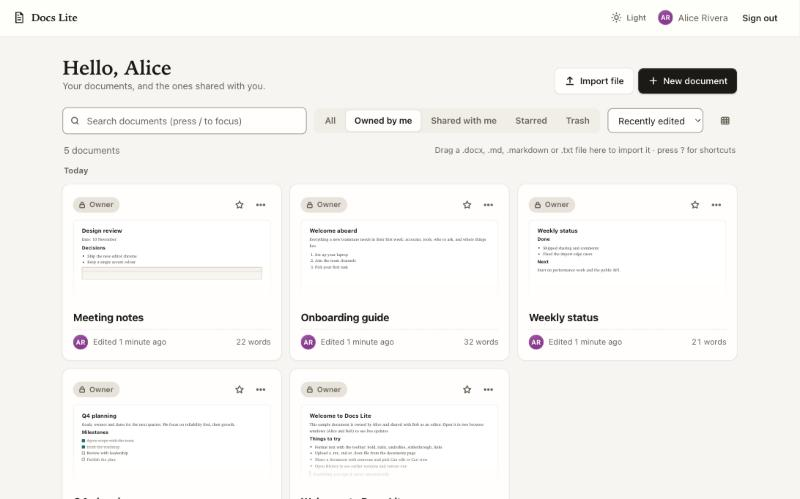
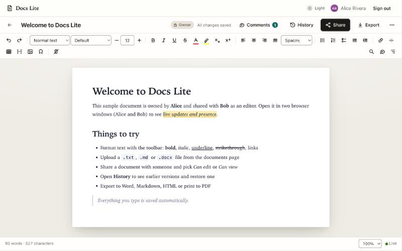
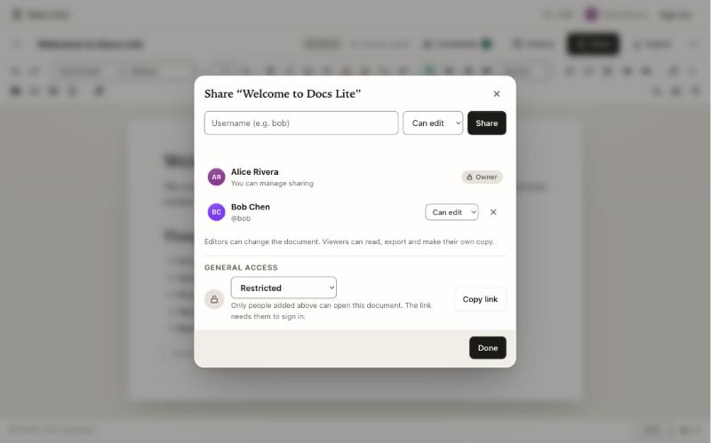

# Docs Lite

A collaborative document editor in the spirit of Google Docs, built as the Ajaia AI-Native Full Stack Developer take-home. No npm dependencies, no build step.



_Screenshots show sample data created while testing; a clean start has only the Welcome document._



## What it does

The brief required: create / rename / edit / save / reopen documents, basic formatting, file upload (`.txt`, `.md`, `.docx`), sharing with roles, and persistence. Those come first and are tested on their own. Everything else below is extra, added afterwards with tests.

**Writing**
- Rich text: bold, italic, underline, strikethrough, headings, bulleted / numbered / **checklists**, quotes, code blocks, links (click one for Open / Edit / Remove), rules, **page breaks**, subscript and superscript.
- **Fonts, sizes, text and highlight colours** (full palette), alignment, **line spacing**, indent / outdent, clear formatting, special characters and emoji.
- **Tables** with a contextual bar (add and remove rows and columns), **pictures** (insert, drag in, paste a screenshot; resized in the browser, size and alt-text controls).
- Find and replace (match case, whole word, highlighted matches), word count, zoom 50-200%, document outline, markdown-style shortcuts (`# `, `- `, `1. `, `> `), keyboard shortcut list.
- **Table of contents** built from your headings (links jump to the heading; it refreshes itself on save).
- **Page setup**: paper size, orientation, margins, header, footer and page numbers. They apply when you print, save as PDF or export to Word.
- **Templates** for new documents (meeting notes, project brief, weekly status, to-do list, proposal, letter, resume).
- **Keyboard-first**: type `/` for a block menu (headings, lists, checklist, table, picture, drawing, divider, page break, table of contents), or press **Ctrl/Cmd+Shift+P** for a command palette that does everything in the app (format, insert, export, jump to a heading, switch theme).
- **Drawing** (pen, highlighter, eraser, colours, undo) inserted as a picture; **word count** with reading ease, reading and speaking time (Chinese, Japanese and Arabic count correctly).
- **Interface polish:** a selection bar above selected text (bold, italic, underline, link, highlight, comment), commented passages tinted in the page, a documents page with grid and list views grouped by recency, keyboard navigation (j/k, Enter, n, /, g-then-letter, ?), illustrated empty states, a first-run tips card, a Drive-style share dialog, version history grouped by day, mobile layouts (compact header, formatting bar docked above the keyboard), Command (⌘) labels on Apple devices, and a white page in dark mode (like Docs and Word) so authors' colours stay readable.
- **Accessibility work** (the link popover opens with Alt+Enter on a link): one toolbar tab stop with arrow keys, labelled menus (`aria-expanded`, Escape, arrow keys), cards as real links, 3:1 control borders and 4.5:1 text contrast, 24 px minimum targets (44 px on touch), reduced-motion and forced-colours support.
- A paste cleaner that keeps the formatting from Google Docs, Word and web pages and drops the junk.

**Files**
- Import `.docx`, `.md`, `.markdown`, `.txt` as new documents, or insert one into an open document (menu, or drag a file onto the editor).
- Export to Word (`.docx`, including pictures, tables, checklists, page breaks, header / footer, page setup), Markdown, HTML, plain text, and print / PDF.

**Sharing and collaboration**
- Share with any user as **editor** or **viewer**. "Owned by me" and "Shared with me" are separate lists with role badges and a "New" marker.
- **Anyone with the link can view**: an unguessable read-only link, no sign-in, which can be replaced or turned off at any time.
- Live updates and presence over server-sent events, **live selections with name flags** for collaborators, live role changes and revocation.
- **Conflicts merge automatically** when two people changed different paragraphs, or different sentences of one paragraph; only a true overlap asks (use theirs / keep mine / save mine as a copy).
- **Comments** on a selected passage, with **replies**, resolve and reopen, shown live.
- **Version history** with preview and a change summary; one-click restore that never rewrites history; **named versions** that are kept forever.
- **Trash** with Undo and 30-day retention, **starred** documents, **Make a copy**, draft recovery after a failed save or an expired session, offline retry.

## Run locally

Requires **Node.js 22.16 or newer** (it uses the built-in `node:sqlite` with FTS5, which older 22.x builds lack). Nothing to install.

```bash
npm start            # http://localhost:3000
npm test             # 186 automated tests: API and access rules, concurrency, live events, docx, sanitiser, fuzzing, migrations
```

Then open **http://localhost:3000/qa/** (development only: the page is switched off in production images unless `QA_PAGE=1`) to run the in-browser test suite for client code that needs a real DOM (paste cleaner, formatting helpers, picture processing). The tab title shows the result (43 tests).

Environment variables (all optional): `PORT` (3000), `DATA_DIR` (`./data`, where `docs.sqlite` lives), `LOG=off` (silence request logs), `TRUST_PROXY=1` (use `X-Forwarded-For` for rate limiting; set it only behind a proxy you control).

## Demo accounts (seeded on first start)

The sign-in screen has one-click buttons for the three accounts.

| Username | Password | Notes |
|---|---|---|
| `alice` | `demo123` | Owns the sample document "Welcome to Docs Lite" |
| `bob` | `demo123` | The sample document is shared with Bob as **editor** |
| `carol` | `demo123` | Nothing shared yet. Good for testing a **viewer** share |

You can also create your own account (Create account tab) to test sharing between real users.

## Suggested review path (5 minutes)

1. Sign in as **alice**. Click **New document**, pick the *Meeting notes* template. Try the toolbar (font, colour, checklist, table, picture). Type `## ` or `- ` at the start of a line. Refresh: everything is still there.
2. Open a second browser window (or a private window) as **bob** on the same document. Edit in either window: changes, presence avatars and comments appear live in the other.
3. As Alice click **Share**, give **carol** *Can view*, then sign in as Carol: the document is read-only (disabled toolbar, banner, 403 from the API if she tries anyway) and she can **Make a copy**. Back as Alice, create a **view link** and open it in a private window.
4. Click **History**, name a version, preview an older one, **Restore**. Click **Comments**, add one from each window and reply to it.
5. On the documents page, **Import file** with a `.docx`, `.md` or `.txt` file. Open a document and use **Export > Word**, or **More > Page setup** and then **Print / save as PDF**.

## Supported upload types

`.docx` (up to 2 MB), `.md`, `.markdown` and `.txt` (up to 1 MB of text; the limit counts characters). Imports keep headings, bullet / numbered / check lists (nested too), tables, pictures, bold, italic, underline, strikethrough, colours, fonts, sizes, alignment, links, quotes, rules and page breaks. Anything else is rejected with a clear message.

## API in one minute

All endpoints are under `/api`, JSON in and out, cookie session. Highlights:

```
POST /login /register /logout    GET /session /me /users
GET  /documents?q=               POST /documents (optional starter content)  POST /documents/import  POST /convert
GET|PATCH|DELETE /documents/:id  (PATCH requires `base_version`: 428 if missing, 409 with the current version on conflict)
PUT  /documents/:id/settings     page setup           PUT|DELETE /documents/:id/star
POST /documents/:id/duplicate    GET /documents/:id/export?format=docx|md|html|txt
GET  /documents/:id/versions[/:vid]   POST /documents/:id/versions/:vid/restore   PUT .../versions/:vid/label
PUT /documents/:id/shares {username, role}   DELETE /documents/:id/shares/:userId   POST|DELETE /documents/:id/link   GET /public/:token (no sign-in)
GET|POST /documents/:id/comments (POST takes parent_id for a reply)   PATCH|DELETE /documents/:id/comments/:cid
GET  /trash   POST /trash/:id/restore   DELETE /trash/:id   (DELETE /documents/:id moves to the trash)
POST /documents/:id/cursor    live selection (relayed, never stored)
GET  /documents?q=               full-text search (trigram index) with highlighted snippets
GET  /documents/:id/events       (server-sent events: hello, presence, update, comment, role, settings, revoked)
GET  /healthz  /readyz  /metrics (loopback or METRICS_TOKEN)
```

## Operations

- **Observability:** every response has `X-Request-Id` (echoed if you send one); logs are one JSON line per request; `/metrics` (Prometheus text: requests by route and status, latency histogram, saves, conflicts, rate limits, SSE clients, memory) is limited to loopback or a `METRICS_TOKEN` bearer; `/readyz` checks the database and turns 503 when shutdown starts, and the shutdown closes event streams so deploys are quick.
- **Reliability:** `Idempotency-Key` on create / import / duplicate / comment (retries and double clicks never duplicate), `ETag` + 304 on document reads, `RateLimit-*` headers, client retries with jittered backoff, SQLite tuned (WAL, `synchronous=NORMAL`, mmap, bounded journal).
- **Scale:** list views read precomputed preview and word-count columns instead of document bodies (listing 3,000 documents of 100 KB each, inserted directly into SQLite, takes under 1.5 seconds); `node scripts/bench.js` measures write throughput (roughly 600-1,100 saves per second with 40 writers, each on their own document, plus 20 readers, on a loaded laptop with an in-memory database; p50 about 20-25 ms, p99 about 350-450 ms); `node scripts/backup.js` takes a consistent online backup with `VACUUM INTO`.
- **Offline (experimental):** a service worker is included so the app shell can open offline and opened documents can be read offline (cleared on sign-out); edits made offline are kept as a draft and saved when you are back. It is registered only on HTTPS or localhost and was **not verified end to end** in the test browser: treat it as best effort.

## Deploy

A `Dockerfile` (non-root, health check, `/data` volume) and a `render.yaml` are included. Any host that runs a Node 22.16+ container works: set `DATA_DIR` to a persistent volume.

- **Render:** New > Blueprint > pick this repo. `render.yaml` mounts a persistent disk at `/data` (disks need a paid plan; on a free plan the SQLite file resets on restart and the demo users and sample document are re-created).
- **Fly.io / Railway:** deploy the Dockerfile, mount a volume at `/data`.
- **Docker:** `docker build -t docs-lite . && docker run -p 3000:3000 -v docs-data:/data docs-lite`

## Security notes

Server-side allow-list HTML sanitiser (attributes limited to a validated `style`, `href`, picture `src` / `alt` / `width`, and a handful of markers (checklist, page break, table of contents, heading ids of the form `h-xxxxxxxx`); only embedded PNG / JPEG / GIF / WebP pictures, never SVG or remote URLs), strict Content-Security-Policy (no inline scripts or `<style>` elements), scrypt-hashed passwords, HttpOnly SameSite=Lax cookies with expiry (the `Secure` flag is added when the request arrives over HTTPS, as reported by a proxy's `X-Forwarded-Proto`), open sign-up and a user list visible to signed-in users (needed to share by username; a real deployment would restrict both), origin check and JSON-only writes, per-address-and-username login limits and a per-address API limit, 144-bit tokens for view links (redacted from request logs), no stack traces to clients, per-user limits on creating documents (500 including the trash, and 200 MB of content at creation, import or copy; edits, version history and sign-ups are bounded only by the per-document limits and the sign-up rate limit, so a user could still grow storage by editing, and a real deployment would add a global storage cap), password hashing off the event loop (asynchronous scrypt).

## Known limits of the demo setup

- The seeded accounts (`alice`, `bob`, `carol`, password `demo123`) exist on every fresh database so reviewers can test sharing; on a public deployment anyone can sign in as them. A real deployment should set `SEED_DEMO=0` to switch the seed off.
- Sharing needs no acceptance from the recipient, and signed-in users can list all usernames (needed to share by username). A real product would add invitations and a block list.
- Sanitising and `.docx` import run on the main thread (guarded by size limits, structural checks and budgets); moving them to a worker would be the next step for heavy use.
- Live streams: the per-user connection cap is O(1), presence changes are coalesced (120 ms) and each event is serialised once; a client that falls 1 MB behind is disconnected and reconnects. Pushing full content to very many viewers of one large document is still costly (a performance audit measured about 300 ms delivery for 2,000 viewers of a 100 KB document); `refetch` is used for large documents, announced at most once a second per document.
- Search cost no longer depends on other users' documents, but the full-text index stores a second copy of every document's text.

## Project layout

```
server.js            entry point (env config, graceful shutdown)
src/app.js           routes, auth, access rules, validation, live events
src/db.js            SQLite schema (version 14), migrations, seed data, password hashing
src/sanitize.js      HTML sanitiser and the .md / .txt converters
src/styles.js        allow-list for inline styles (colours, sizes, fonts, alignment, spacing)
src/pagesetup.js     page setup validation and @page CSS
src/docx.js          dependency-free .docx reader and writer (zip + OOXML)
src/export.js        Markdown / text / HTML exporters
src/htmltree.js      tiny parser for the sanitised HTML subset
public/              the single-page UI (ES modules, no build step)
public/qa/           in-browser tests for client code
test/                node:test suites
```
